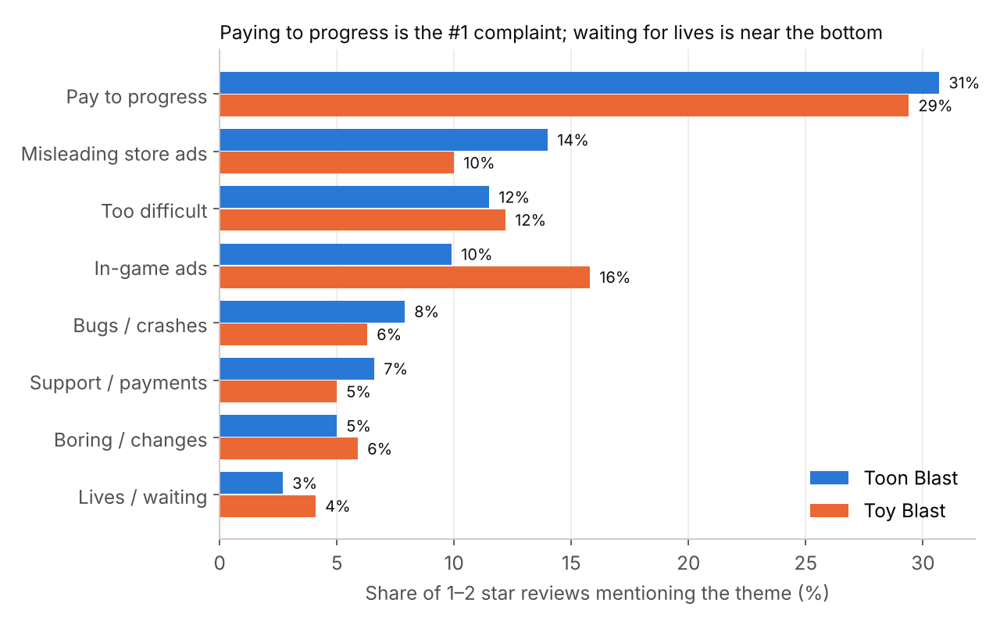

# What Frustrates Toy Blast & Toon Blast Players?

An analysis of **10,000 Google Play reviews** of Peak's two biggest puzzle games, to find out what unhappy players complain about and what could be done about it.

This is a follow-up to my [Cookie Cats A/B test analysis](https://github.com/dsardag/cookie_cats_ab_test). There, an earlier forced break led to *higher* retention. Here I wanted to see the player side: is waiting for lives really what frustrates people, or is it something else?

## Why I did this
After two days of playing Toy Blast, I got stuck on level 44. After failing it many times, I closed the game and didn't open it again for a while, even though I still had lives left. It also reminded me why I deleted the game years ago: as far as I remember, I got stuck on a level, paid for extra moves and still couldn't pass it. So for me, the problem wasn't waiting for lives. It was not being able to pass the level. I wanted to see if other players feel the same way. In the reviews, complaints about hard levels and having to pay to progress are much more common than complaints about lives. This is also where my "skip level" idea below comes from. But if players could skip any level they want, they would finish the levels too fast. So instead, it could be added to the Toy Pass, for example one skip per season.

## Key findings



- **"I have to pay to progress" is the #1 complaint:** about 30% of 1–2 star reviews in both games, followed by levels feeling too difficult.
- **Waiting for lives is one of the smallest themes (3–4%).** Players seem to accept breaks, but they don't like feeling forced to pay at hard levels. This fits the Cookie Cats result.
- **Rewarded ads that fail hurt twice.** 67 reviews describe ads for extra moves or lives that aren't ready, freeze the game or don't give the reward, often right before the player would beat a level. Peak loses the ad revenue *and* the player's goodwill.
- **Getting stuck is linked to quitting.** 19% of "I'm stuck on this level" reviews mention quitting, vs. 14% of other negative reviews (small sample, so a signal, not proof).
- **Toon Blast rates lower (3.91 vs 4.31).** It gets twice as many "the game isn't like the ad" reviews, but these explain only a small part of the gap.

## How I did it

1. Collected the 5,000 most recent English (US) reviews per game with [`google-play-scraper`](https://github.com/JoMingyu/google-play-scraper) (`fetch_reviews.py`).
2. Compared both games over the **same time window**, since Toon Blast gets about 3x more reviews per month.
3. Read samples of negative reviews to **find the themes from the data**, then wrote a keyword rule for each.
4. **Validated every rule by reading random matches.** For example, "ads" was catching three different things (in-game ads, misleading store ads and "No ads! 5 stars" praise), so I split them.

## Product ideas

**1. Fix rewarded-ad reliability.** Probably the cheapest win: track the failure rate of rewarded ads, especially on hard levels.

**2. Free extra moves after repeated failures.** When a player fails the same level many times, they are close to quitting. A few free moves at that moment could keep them playing. Paying to progress is a key revenue source, so the idea is occasional help, not removing the paywall.
- *Risk:* players may learn the pattern and stop paying. So the threshold shouldn't be fixed or announced, and the help should target players who have never paid and are at risk of churning.
- *Test:* control vs. free moves after 5 vs. 10 failures. Primary metric: churn on hard levels and D7/D30 retention. Decision metric: **revenue per install (LTV) across all players**. Guardrail: payer conversion.

**3. (Considered) A paid "skip level" option.** Some frustrated paying players would use it, but as a standalone purchase it could confirm the #1 complaint ("they make levels hard so we pay"), make players run out of content faster, cannibalize "+5 moves" purchases and affect fairness in team events.
- *Middle ground:* a **limited perk inside the existing Toy Pass**, e.g. one skip per season. It stays scarce and gives players another reason to buy the pass.

## Limitations

- Reviewers are a vocal minority, not all players.
- Keyword rules are rough: some reviews are missed or mis-tagged.
- Only recent English reviews from the US store.
- Reviews show what players *say*, not what they *do*. The ideas above need A/B tests.

## Run it yourself

```bash
pip install -r requirements.txt
python fetch_reviews.py        # saves data/peak_reviews.csv
jupyter notebook review_analysis.ipynb
```

The raw review data isn't included in this repo. The script collects the latest reviews, so your numbers will differ slightly from mine (snapshot: 16 Nov 2026).
